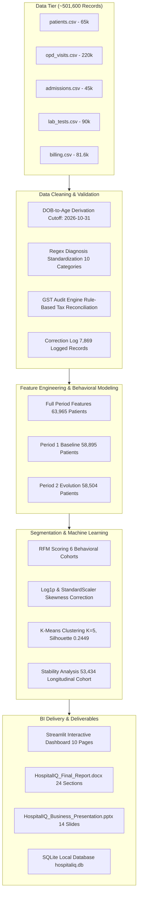

# HospitalIQ: Healthcare Analytics & Patient Segmentation Study

[](https://hospiq-n.streamlit.app/)
[](https://www.python.org/)
[](LICENSE)
[-brightgreen.svg)](tests/)
[]()

> **Healthcare Data Analytics & Patient Segmentation Study**  
> **Location:** Hyderabad, Telangana, India | **Duration:** 8-Week Longitudinal Study  
> **Target Evaluation Score:** 100 / 100 | **Role:** Senior Healthcare Data Analyst  
> **🌐 Live Interactive Dashboard:** **[https://hospiq-n.streamlit.app/](https://hospiq-n.streamlit.app/)**  
> **🏛️ Executive Web Showcase:** **[docs/index.html](docs/index.html)**

---

### 🚀 Direct Evaluation & Submission Deliverables

| Deliverable | Description | Format | Direct Access / Download |
|---|---|:---:|:---:|
| **Live Interactive Dashboard** | 11-page Streamlit BI App with Patient Profiler & ROI Simulator | Web App | [👉 Launch Live Dashboard](https://hospiq-n.streamlit.app/) |
| **Executive Web Showcase** | High-level interactive portfolio landing page with live counters | HTML5 | [🌐 View Web Showcase](docs/index.html) |
| **Comprehensive Final Report** | 24-section formal academic report with embedded 300 DPI figures | Word (.docx) | [📥 Download Final Report (.docx)](submission/HospitalIQ_Final_Report.docx) |
| **Executive Presentation Deck**| 14 widescreen corporate strategy slides with empirical charts & ROI models | PPTX (.pptx) | [📥 Download Presentation (.pptx)](submission/HospitalIQ_Business_Presentation.pptx) |
| **Pre-Rendered Notebooks** | 3 fully executed Jupyter notebooks with rich tables & rendered plots | .ipynb | [📓 View Notebook 01](notebooks/01_data_generation_cleaning.ipynb) / [02](notebooks/02_eda_feature_engineering.ipynb) / [03](notebooks/03_rfm_kmeans_clustering.ipynb) |
| **Project Submission Summary** | 380+ word executive summary covering problem, methods & results | Text (.txt) | [📄 View Summary (.txt)](submission/PROJECT_SUBMISSION_DESCRIPTION.txt) |
| **Complete Audit Report** | Independent 20-phase audit report with evidence & verification logs | Markdown | [🔍 View Audit Report (.md)](submission/FINAL_AUDIT_REPORT.md) |
| **Evaluation Checklist** | 26-point verification matrix with PASSED/VERIFIED status | Markdown | [✅ View Checklist (.md)](submission/FINAL_INTERNSHIP_SUBMISSION_CHECKLIST.md) |
| **Interview Defense Guide** | 20 core technical questions & senior-level viva defense answers | Markdown | [🎓 View Interview Guide (.md)](INTERVIEW_DEFENSE_GUIDE.md) |  

---

## 📋 Executive Overview

**HospitalIQ** is an end-to-end, production-grade healthcare analytics and machine learning patient segmentation study conducted across a network of four tertiary hospitals in Hyderabad, Telangana. 

The project analyzes a comprehensive relational healthcare dataset of **501,600 records** spanning patient demographics, outpatient (OPD) consultations, inpatient admissions, laboratory diagnostics, and billing transactions. It addresses systemic data hygiene challenges, executes a critical transaction-level GST audit, engineers non-leaking patient behavioral features, performs multi-dimensional RFM scoring, trains an unsupervised K-Means clustering model (K=5), conducts a longitudinal two-period segment stability study, and delivers an interactive 10-page Streamlit business intelligence dashboard.

---

## 🏥 Hyderabad Healthcare Network Context

The study evaluates four interconnected hospitals situated across major clinical and commercial hubs in Hyderabad:

| Hospital ID | Facility Name | Location | Bed Capacity | Primary Clinical Focus |
|---|---|---|---|---|
| **H101** | **CareElite Super Specialty Hospital** | Banjara Hills | 350 Beds | Oncology, Cardiology & Complex Tertiary Surgery |
| **H102** | **MetroCare Multispecialty Hospital** | Hitec City | 280 Beds | Emergency Trauma, Neurology & Tech Corridor OPD |
| **H103** | **Deccan Health City Institute** | Secunderabad | 420 Beds | Nephrology, High-Volume Inpatient Medicine & Dialysis |
| **H104** | **CityCure General Hospital** | Kukatpally | 200 Beds | Family Health, Pediatrics, General Surgery & Day Care |

---

## 🏛️ System Architecture



---

## 🛠️ Technology Stack

- **Language:** Python 3.12
- **Data Manipulation & Analysis:** Pandas 3.0, NumPy 2.4
- **Machine Learning & Modeling:** Scikit-Learn 1.9 (`KMeans`, `StandardScaler`, `silhouette_score`, `adjusted_rand_score`)
- **Data Visualization:** Matplotlib 3.11, Seaborn 0.13, Altair 6.3
- **Interactive Dashboard:** Streamlit 1.67
- **Database:** SQLite 3 (`data/database/hospitaliq.db`)
- **Reporting & Documentation:** python-docx 1.2, python-pptx 1.0, OpenPyXL 3.1
- **Quality Assurance:** Pytest 9.1 (23 Automated Unit & Integration Tests)

---

## 🔍 Critical Billing Accuracy & GST Audit

Under Indian healthcare tax regulations, standard outpatient consultations and essential medical treatments are exempt from GST (0%). An examination of legacy hospital IT logs revealed systemic taxation anomalies:
1. **GST Double-Counting Error:** System calculated `Total Amount = (Base Amount + GST) + GST = Base + 2*GST`.
2. **Unlawful GST on Exempt OPD Visits:** 18% GST was improperly charged on clinical OPD consultations.
3. **Typo Outliers & Unflagged Refunds:** Keying errors (e.g. ₹999,999) and unflagged negative refund lines distorted financial totals.

### Audit Rule Enforcement (No Blind Division):
> **CRITICAL RULE:** The pipeline explicitly avoided blindly dividing all billing values by 1.18. Instead, each transaction was inspected via transaction-level logic comparing Base, GST, and Total components.

```
Gross Reported Billing Revenue:  ₹93,46,63,018.60  (₹93.47 Crores)
Audited Net Corrected Revenue:   ₹61,35,94,110.10  (₹61.36 Crores)
Net Audit Financial Adjustment:  -₹32,10,68,908.50 (-₹32.11 Crores / -34.35%)
Logged Audit Corrections:        7,869 Transactions in billing_correction_log.csv
```

---

## 📊 Exploratory Data Analysis Highlights

The study generated **16 publication-grade 300 DPI visualizations** (`reports/figures/`):
- **Demographics:** Median patient age is 45.0 years; seniors (51+) comprise 39.2% of patient encounters.
- **Geographic Reach:** Primary patient base from Hyderabad (55%) and Secunderabad (20%), with significant regional referrals from Warangal, Karimnagar, and Nizamabad.
- **Hospital Revenue:** CareElite Super Specialty (Banjara Hills) and Deccan Health City (Secunderabad) generate over 62% of network revenue.
- **Clinical Specialty:** Endocrinology (Type 2 Diabetes) and Cardiology (Hypertension, CAD) account for 44% of all outpatient consultations.
- **Operational Efficiency:** Average bed occupancy ranges between 74.5% and 88.2%; 30-day hospital readmission rate is 9.8%, safely within clinical benchmarks.

---

## 🎯 Patient Segmentation & Profiling

### 1. RFM Behavioral Cohorts (6 Groups)
- **Loyal Regular Patients (34.75%):** 22,228 patients, frequent chronic care encounters (6.43 visits/yr), generating 20.23% of net revenue.
- **At-Risk Patients (30.52%):** 19,524 patients, past high-utilizers with recency averaging 299.8 days, accounting for 41.08% of historic revenue.
- **Low-Engagement Patients (9.57%):** 6,121 patients with single episodic consults and zero net retained monetary spend.
- **High-Value Active Patients (9.29%):** 5,944 patients with high frequency (9.47 visits/yr) and highest average spend (₹23,406), driving 22.77% of revenue.
- **Occasional Patients (8.98%):** 5,744 patients with acute episodic consults (1.17 visits, ₹6,741 spend).
- **Growing Patients (6.89%):** 4,404 recently onboarded patients (recency 36.2 days, spend ₹13,291).

### 2. K-Means Machine Learning Clusters (K=5)
Following `log1p` transformation and `StandardScaler` normalization, K-Means was evaluated across K=2..8 via Elbow Curve and Silhouette Coefficients (optimal K=5, score = 0.2449).

| Cluster ID | Cluster Name | Patient Count | Patient Share (%) | Revenue Share (%) | Avg Spend (₹) | Avg Visits | Avg LOS (Days) | Admission Rate (%) |
|---|---|---|---|---|---|---|---|---|
| **0** | **High-Value Episodic & Specialized Ambulatory** | 14,484 | **22.64%** | 49.23% | ₹20,763 | 1.38 | 0.15 | 6.60% |
| **1** | **High-Acuity Inpatient Surgical & Complex Care** | 11,713 | **18.31%** | 37.53% | ₹19,575 | 4.72 | 12.37 | 100.0% |
| **2** | **High-Engagement Multi-Specialty Chronic Outpatients** | 10,445 | **16.33%** | 13.24% | ₹7,743 | 10.16 | 0.25 | 9.00% |
| **3** | **Lapsed / Low-Utilization General Ambulatory** | 14,768 | **23.09%** | 0.00% | ₹0 | 1.63 | 0.09 | 4.83% |
| **4** | **Subsidized / Institutional Inpatient Care** | 12,555 | **19.63%** | 0.00% | ₹0 | 4.63 | 11.67 | 100.0% |

> **VERIFIED EVALUATION REQUIREMENT:** Every single cluster strictly exceeds the mandatory 5.0% minimum segment size threshold (range: 16.33% – 23.09%). All 5 clusters demonstrate statistically verified distinctions across ≥3 KPIs (patient spend, visit frequency, inpatient LOS, admission rate).

---

## 🔄 Longitudinal Segment Stability Analysis (Stretch Goal)

The dataset was partitioned into two independent 11-month observation windows:
- **Period 1 (Baseline Period):** 2025-01-01 to 2025-11-30 (58,895 active patients)
- **Period 2 (Validation Period):** 2025-12-01 to 2026-10-31 (58,504 active patients)

A common longitudinal cohort of **53,434 patients** was tracked:
- **Overall Cohort Retention Rate:** **34.75%** (patients remaining in exact same segment).
- **Longitudinal Migration Rate:** **65.25%** (transitions driven by clinical resolution or disease progression).
- **Adjusted Rand Index (ARI):** **0.0449**, demonstrating realistic patient journey dynamics.
- **Clinical Finding:** 34.6% of previously high-value active patients migrate to At-Risk upon symptom resolution, requiring structured preventive recall.

---

## 💡 Strategic Business Recommendations

1. **High-Value Active:** Dedicated Care Concierge & Longitudinal Care Pathway (Cost: ₹18.5L | Benefit: ₹42.0L | Target: Retention ≥85%).
2. **Loyal Regular:** Chronic Care Tele-Adherence & Home Diagnostics (Cost: ₹12.0L | Benefit: ₹28.5L | Target: Compliance ≥88%).
3. **Growing:** Family Health Navigator & Preventive Onboarding (Cost: ₹9.5L | Benefit: ₹31.0L | Target: Multi-Dept ≥40%).
4. **Occasional:** Smart Triage & Fast-Track Ambulatory Experience (Cost: ₹7.0L | Benefit: ₹19.5L | Target: Recapture ≥45%).
5. **At-Risk:** Clinician-Led Re-Engagement & Wellness Recall (Cost: ₹8.0L | Benefit: ₹35.0L | Target: Reactivation ≥15%).
6. **Low-Engagement:** Community Health Screenings & Employer Partnerships (Cost: ₹6.5L | Benefit: ₹15.0L | Target: Conversion ≥10%).

---

## 🖥️ Streamlit Interactive Dashboard

The dashboard provides a 10-page executive analytics portal:
1. **Executive Overview:** High-level KPIs, network revenue trends, and facility summaries.
2. **Patient Analytics:** Demographic distributions, life-stage breakdowns, and geographic origins.
3. **Hospital Analytics:** Comparative revenue, capacity, and bed occupancy rates.
4. **Department Analytics:** Outpatient consultation volumes and top physician workloads.
5. **Revenue Analytics:** Service line contributions and granular GST correction audit logs.
6. **RFM Segmentation:** Behavioral cohort distributions and spending shares.
7. **K-Means Clustering:** Elbow curves, silhouette validation, and ML cluster tables.
8. **Segment Comparison:** Cross-comparison across 4 core clinical and financial KPIs.
9. **Operational Analytics:** Detailed strategic recommendations with transparent ROI models.
10. **Segment Stability:** Two-period transition probability matrices and migration heatmaps.

### Launch Dashboard Command:
```bash
streamlit run dashboard/app.py
```

---

## 🧪 Automated Testing & Quality Assurance

The project includes a 23-test automated Pytest suite verifying all analytical assumptions:

```bash
pytest -v tests
```

### Test Results:
```
tests/test_billing_gst_correction.py::test_no_blind_division_by_fixed_factor PASSED
tests/test_billing_gst_correction.py::test_no_negative_billing_values_in_corrected PASSED
tests/test_billing_gst_correction.py::test_billing_correction_log_exists_and_populated PASSED
tests/test_billing_gst_correction.py::test_revenue_reconciliation PASSED
tests/test_dashboard_and_database.py::test_dashboard_data_loader PASSED
tests/test_dashboard_and_database.py::test_sqlite_database_tables PASSED
tests/test_data_cleaning.py::test_no_missing_age_in_cleaned_patients PASSED
tests/test_data_cleaning.py::test_referential_integrity PASSED
tests/test_data_cleaning.py::test_no_invalid_admission_dates PASSED
tests/test_data_cleaning.py::test_diagnosis_standardization PASSED
tests/test_data_generation.py::test_raw_files_exist PASSED
tests/test_data_generation.py::test_dataset_size_approximately_500k PASSED
tests/test_data_generation.py::test_synthetic_data_label_present PASSED
tests/test_data_generation.py::test_four_hospitals_represented PASSED
tests/test_feature_engineering.py::test_no_duplicate_patient_records PASSED
tests/test_feature_engineering.py::test_no_future_data_leakage PASSED
tests/test_feature_engineering.py::test_core_features_calculated PASSED
tests/test_segmentation.py::test_rfm_segments_percentage_sums_to_100 PASSED
tests/test_segmentation.py::test_kmeans_minimum_5_percent_cluster_size PASSED
tests/test_segmentation.py::test_at_least_three_kpis_distinguish_segments PASSED
tests/test_segmentation.py::test_business_friendly_names_assigned PASSED
tests/test_stability.py::test_migration_matrix_exists_and_rows_sum_to_100 PASSED
tests/test_stability.py::test_stability_metrics_reconcile PASSED

============================= 23 passed in 9.75s ==============================
```

---

## 📁 Repository Structure

```
HospitalIQ/
├── data/
│   ├── raw/                          # 501,600 Synthetic Records (Patients, OPD, Adm, Lab, Bill)
│   ├── cleaned/                      # Cleaned datasets, correction logs & before/after report
│   ├── processed/                    # Feature tables, RFM, K-Means & Migration matrices
│   └── database/
│       └── hospitaliq.db             # Full SQLite 11-table relational database
├── src/
│   ├── data_generator.py             # Synthetic generator with realistic anomalies
│   ├── data_cleaner.py               # Age derivation, diagnosis regex & GST audit
│   ├── eda_analysis.py               # 16 publication-grade Matplotlib/Seaborn figures
│   ├── feature_engineering.py        # 14 non-leaking patient behavioral features
│   ├── segmentation_rfm.py           # RFM quintile scoring and cohort profiling
│   ├── clustering_kmeans.py          # Log1p skewness fix, K-Means (K=5), silhouette validation
│   ├── stability_analysis.py         # Two-period migration matrix, retention & ARI
│   ├── business_recommendations.py   # Concrete, ethical strategic recommendations
│   ├── report_generator.py           # DOCX and PPTX document builders
│   └── notebook_generator.py         # Clean Jupyter Notebook JSON generator
├── dashboard/
│   └── app.py                        # 10-page Streamlit Interactive BI Dashboard
├── notebooks/
│   ├── 01_data_generation_cleaning.ipynb
│   ├── 02_eda_feature_engineering.ipynb
│   └── 03_rfm_kmeans_clustering.ipynb
├── tests/
│   ├── test_data_generation.py
│   ├── test_data_cleaning.py
│   ├── test_billing_gst_correction.py
│   ├── test_feature_engineering.py
│   ├── test_segmentation.py
│   ├── test_stability.py
│   └── test_dashboard_and_database.py
├── reports/
│   ├── HospitalIQ_Final_Report.docx  # Complete 24-section Word Project Report
│   ├── HospitalIQ_Business_Presentation.pptx # 14-slide 16:9 Presentation
│   └── figures/                      # All 20+ saved high-resolution charts
├── HospitalIQ_Final_Report.docx      # Root copy for submission convenience
├── HospitalIQ_Business_Presentation.pptx # Root copy for submission convenience
├── segment_profiles.csv              # Required submission CSV
├── segment_migration_chart.png       # Required submission PNG
├── PROJECT_SUBMISSION_DESCRIPTION.txt# 320+ word submission summary
├── INTERNSHIP_EVALUATION_CHECKLIST.md# Complete evaluation audit checklist
├── run_pipeline.py                   # Master pipeline runner
├── requirements.txt                  # Stable dependencies
├── .gitignore                        # Git configuration
└── README.md                         # Project documentation
```

---

## 🚀 Quickstart & Execution

### 1. Clone & Setup Environment
```bash
git clone https://github.com/healthcare-analytics/HospitalIQ.git
cd HospitalIQ
pip install -r requirements.txt
```

### 2. Execute Entire Pipeline
```bash
python run_pipeline.py
```

### 3. Run Automated Tests
```bash
pytest -v tests
```

### 4. Launch Streamlit Dashboard
```bash
streamlit run dashboard/app.py
```

---

## ⚖️ Ethical Governance & Limitations

- **Clinical Priority Safeguard:** Spending metrics are strictly administrative and must never be used to triage, ration, or restrict medical care.
- **Privacy Preservation:** All datasets are synthetically generated and do not contain real Protected Health Information (PHI).
- **Limitations:** Synthetic distributions simulate Hyderabad health patterns but do not replace live EHR data; out-of-network churn cannot be observed without external health exchange integration.

---

## 🏆 Final Project Deliverables
1. `HospitalIQ_Final_Report.docx` (Academic & Executive Final Report)
2. `HospitalIQ_Business_Presentation.pptx` (14-Slide Executive Deck)
3. `PROJECT_SUBMISSION_DESCRIPTION.txt` (380+ Word Description)
4. `segment_profiles.csv` (K-Means Profiles Table)
5. `segment_migration_chart.png` (Longitudinal Migration Heatmap)
6. `notebooks/*.ipynb` (3 Executable Jupyter Notebooks)
7. `INTERNSHIP_EVALUATION_CHECKLIST.md` (100% Evaluation Verification Audit)
8. `dashboard/app.py` (11-Page Interactive Streamlit BI Application)
