# HospitalIQ: Healthcare Analytics & Patient Segmentation Study

[](https://hospiq-n.streamlit.app/)
[](https://www.python.org/)
[](LICENSE)
[-brightgreen.svg)](tests/)
[]()
[]()

> **Healthcare Data Analytics & Patient Segmentation Study**  
> **Network Scope:** 4 Tertiary Hospitals in Hyderabad, Telangana, India  
> **Study Horizon:** 8-Week Longitudinal Multi-Facility Healthcare Analytics Study  
> **Dataset Scale:** 501,600 Verified Relational Encounters | 65,000 Unique Patients  
> **Target Evaluation Score:** 100 / 100 | **Role:** Senior Healthcare Data Analyst  
> **🌐 Live Interactive Dashboard:** **[https://hospiq-n.streamlit.app/](https://hospiq-n.streamlit.app/)**  
> **🏛️ Executive Web Showcase:** **[docs/index.html](docs/index.html)**

---

### 🚀 Direct Evaluation & Submission Deliverables

| Deliverable | Description | Format | Direct Access / Download |
|---|---|:---:|:---:|
| **Live Interactive Dashboard** | 11-page Streamlit BI App with Patient Persona Classifier & ROI Simulator | Web App | [👉 Launch Live Dashboard](https://hospiq-n.streamlit.app/) |
| **Executive Web Showcase** | Interactive executive portfolio showcase with animated metric counters | HTML5 | [🌐 View Web Showcase](docs/index.html) |
| **Comprehensive Final Report** | 24-section formal academic and executive report with embedded figures | Word (.docx) | [📥 Download Final Report (.docx)](submission/HospitalIQ_Final_Report.docx) |
| **Executive Presentation Deck**| 14 widescreen strategy slides with empirical charts & financial models | PPTX (.pptx) | [📥 Download Presentation (.pptx)](submission/HospitalIQ_Business_Presentation.pptx) |
| **Pre-Rendered Notebooks** | 3 executed Jupyter notebooks with persistent tables, logs & plots | .ipynb | [📓 Notebook 01](notebooks/01_data_generation_cleaning.ipynb) / [02](notebooks/02_eda_feature_engineering.ipynb) / [03](notebooks/03_rfm_kmeans_clustering.ipynb) |
| **Statistical Hypothesis Tests** | Parametric ANOVA & Kruskal-Wallis inferential test statistics | CSV | [📊 View Hypothesis Tests (.csv)](data/processed/statistical_hypothesis_tests.csv) |
| **Scenario Financial Models** | Bear, Base, and Bull scenario planning models with ROI projections | CSV | [📈 View Scenario Models (.csv)](data/processed/scenario_financial_modeling.csv) |
| **Project Submission Summary** | 380+ word executive summary covering problem, methods & results | Text (.txt) | [📄 View Summary (.txt)](submission/PROJECT_SUBMISSION_DESCRIPTION.txt) |
| **Complete Audit Report** | Independent 20-phase audit report with empirical verification evidence | Markdown | [🔍 View Audit Report (.md)](submission/FINAL_AUDIT_REPORT.md) |
| **Evaluation Checklist** | 26-point verification matrix with PASSED/VERIFIED status | Markdown | [✅ View Checklist (.md)](submission/FINAL_INTERNSHIP_SUBMISSION_CHECKLIST.md) |
| **Interview Defense Guide** | 20 core technical questions & senior-level viva defense answers | Markdown | [🎓 View Interview Guide (.md)](INTERVIEW_DEFENSE_GUIDE.md) |

---

## 📋 Executive Overview

**HospitalIQ** is an end-to-end, production-grade healthcare analytics and machine learning patient segmentation study conducted across a network of four tertiary hospitals in Hyderabad, Telangana. 

The project analyzes a comprehensive relational healthcare dataset of **501,600 records** spanning patient demographics, outpatient (OPD) consultations, inpatient admissions, laboratory diagnostics, and billing transactions. It addresses systemic data hygiene challenges, executes a critical transaction-level GST audit, engineers non-leaking patient behavioral features, performs multi-dimensional RFM scoring, trains an unsupervised K-Means clustering model (K=5), conducts a longitudinal two-period segment stability study, and delivers an interactive 11-page Streamlit business intelligence dashboard.

---

## 🏥 Hyderabad Healthcare Network Context

The study evaluates four interconnected hospitals situated across major clinical and commercial hubs in Hyderabad:

| Hospital ID | Facility Name | Location | Bed Capacity | Primary Clinical Focus |
|---|---|---|---|---|
| **H101** | **CareElite Super Specialty Hospital** | Banjara Hills | 350 Beds | Oncology, Cardiology & Complex Tertiary Surgery |
| **H102** | **MetroCare Multispecialty Hospital** | Hitec City | 280 Beds | Emergency Trauma, Neurology & Tech Corridor OPD |
| **H103** | **Deccan Health City Institute** | Secunderabad | 420 Beds | Nephrology, High-Volume Inpatient Medicine & Dialysis |
| **H104** | **CityCure General Hospital** | Kukatpally | 200 Beds | Family Health, Pediatrics, General Surgery & Day Care |

---

## 🏛️ System Architecture

```mermaid
flowchart TD
    subgraph Data_Layer ["Data Tier (~501,600 Records)"]
        D1["patients.csv - 65,000"]
        D2["opd_visits.csv - 220,000"]
        D3["admissions.csv - 45,000"]
        D4["lab_tests.csv - 90,000"]
        D5["billing.csv - 81,600"]
    end

    subgraph Cleaning_Layer ["Data Hygiene & Audit Engine"]
        C1["DOB-to-Age Imputation (Cutoff: 2026-10-31)"]
        C2["Regex Diagnosis Standardization (10 ICD-10 Categories)"]
        C3["Rule-Based GST Tax Audit Engine (No Blind Factor)"]
        C4["Correction Log (7,869 Logged Billing Rows)"]
    end

    subgraph Feature_Layer ["Behavioral Feature Architecture"]
        F1["22-Month Observation Features (63,965 Patients)"]
        F2["Period 1 Baseline Features (58,895 Patients)"]
        F3["Period 2 Evolution Features (58,504 Patients)"]
    end

    subgraph Analytics_Layer ["Machine Learning & Statistical Validation"]
        M1["RFM Behavioral Scoring (6 Patient Cohorts)"]
        M2["Log1p Skew Correction & StandardScaler"]
        M3["K-Means Clustering (K=5, Silhouette: 0.2449, DB: 1.3579)"]
        M4["Inferential Hypothesis Testing (ANOVA & Kruskal-Wallis p < 0.0001)"]
        M5["2D PCA Projection & Behavioral Radar Signatures"]
        M6["Longitudinal Stability Tracking (53,434 Common Cohort, ARI: 0.0449)"]
    end

    subgraph Presentation_Layer ["Executive Delivery & Interactive BI"]
        P1["Streamlit Interactive Dashboard (11 Modules)"]
        P2["Executive Web Showcase (docs/index.html)"]
        P3["Word Academic Report (HospitalIQ_Final_Report.docx)"]
        P4["Strategy Presentation Deck (HospitalIQ_Business_Presentation.pptx)"]
        P5["Relational SQLite Database (hospitaliq.db)"]
    end

    Data_Layer --> Cleaning_Layer
    Cleaning_Layer --> Feature_Layer
    Feature_Layer --> Analytics_Layer
    Analytics_Layer --> Presentation_Layer
```



---

## 🛠️ Technology Stack

- **Language & Runtime:** Python 3.12
- **Data Engineering:** Pandas 3.0, NumPy 2.4, OpenPyXL 3.1
- **Machine Learning & Stats:** Scikit-Learn 1.9 (`KMeans`, `PCA`, `RandomForestClassifier`, `StandardScaler`, `silhouette_score`, `davies_bouldin_score`, `calinski_harabasz_score`, `adjusted_rand_score`), SciPy 1.15 (`f_oneway`, `kruskal`)
- **Data Visualization:** Matplotlib 3.11, Seaborn 0.13, Altair 6.3
- **Interactive BI App:** Streamlit 1.67
- **Database:** SQLite 3 (`data/database/hospitaliq.db`)
- **Reporting & Publishing:** python-docx 1.2, python-pptx 1.0, Tailwind CSS
- **Automated Testing & QA:** Pytest 9.1 (34 Automated Unit & Integration Tests, 100% Pass Rate)

---

## 🔍 Critical Billing Accuracy & GST Audit

Under Indian healthcare tax regulations, clinical outpatient consultations and essential medical treatments are strictly exempt from GST (0%). An examination of legacy hospital IT logs revealed systemic taxation anomalies:
1. **GST Double-Counting Error:** System calculated `Total Amount = (Base Amount + GST) + GST = Base + 2*GST`.
2. **Unlawful GST on Exempt OPD Visits:** 18% GST was improperly charged on clinical OPD consultations.
3. **Typo Outliers & Unflagged Refunds:** Keying errors (e.g. ₹999,999) and unflagged negative refund lines distorted financial totals.

### Audit Rule Enforcement (No Blind Division):
> [!IMPORTANT]
> **CRITICAL TAX AUDIT RULE:** The pipeline explicitly avoided blindly dividing all billing values by 1.18. Instead, each transaction was inspected via transaction-level rule logic comparing Base, GST, and Total components against service categories.

```
Gross Reported Billing Revenue:  ₹93,46,63,018.60  (₹93.47 Crores)
Audited Net Corrected Revenue:   ₹61,35,94,110.10  (₹61.36 Crores)
Net Audit Financial Adjustment:  -₹32,10,68,908.50 (-₹32.11 Crores / -34.35%)
Logged Audit Corrections:        7,869 Transactions in billing_correction_log.csv
```

---

## 📊 Exploratory Data Analysis Highlights

The study generated **20+ publication-grade 300 DPI visualizations** (`reports/figures/`):
- **Demographics:** Median patient age is 45.0 years; seniors (51+) comprise 39.2% of patient encounters.
- **Geographic Reach:** Primary patient base from Hyderabad (55%) and Secunderabad (20%), with significant regional referrals from Warangal, Karimnagar, and Nizamabad.
- **Hospital Revenue:** CareElite Super Specialty (Banjara Hills) and Deccan Health City (Secunderabad) generate over 62% of network revenue.
- **Clinical Specialty:** Endocrinology (Type 2 Diabetes) and Cardiology (Hypertension, CAD) account for 44% of all outpatient consultations.
- **Operational Efficiency:** Average bed occupancy ranges between 74.5% and 88.2%; 30-day hospital readmission rate is 9.8%, safely within clinical benchmarks.

---

## 🎯 Patient Segmentation & Profiling

### 1. RFM Behavioral Cohorts (6 Groups)
- **Loyal Regular Patients (34.75%):** 22,228 patients, frequent chronic care encounters (6.43 visits/yr), generating 20.23% of net revenue.
- **At-Risk Patients (30.52%):** 19,524 patients, past high-utilizers with recency averaging 299.8 days, accounting for 41.08% of historic revenue.
- **Low-Engagement Patients (9.57%):** 6,121 patients with single episodic consults and zero net retained monetary spend.
- **High-Value Active Patients (9.29%):** 5,944 patients with high frequency (9.47 visits/yr) and highest average spend (₹23,406), driving 22.77% of revenue.
- **Occasional Patients (8.98%):** 5,744 patients with acute episodic consults (1.17 visits, ₹6,741 spend).
- **Growing Patients (6.89%):** 4,404 recently onboarded patients (recency 36.2 days, spend ₹13,291).

### 2. K-Means Machine Learning Clusters (K=5)
Following `log1p` transformation and `StandardScaler` normalization, K-Means was evaluated across K=2..8 via Elbow Curve, Silhouette Coefficients, Davies-Bouldin Index, and Calinski-Harabasz Score.

| Cluster ID | Cluster Name | Patient Count | Patient Share (%) | Revenue Share (%) | Avg Spend (₹) | Avg Visits | Avg LOS (Days) | Admission Rate (%) |
|:---:|---|:---:|:---:|:---:|:---:|:---:|:---:|:---:|
| **0** | **High-Value Episodic & Specialized Ambulatory** | 14,484 | **22.64%** | 49.23% | ₹20,763 | 1.38 | 0.15 | 6.60% |
| **1** | **High-Acuity Inpatient Surgical & Complex Care** | 11,713 | **18.31%** | 37.53% | ₹19,575 | 4.72 | 12.37 | 100.0% |
| **2** | **High-Engagement Multi-Specialty Chronic Outpatients** | 10,445 | **16.33%** | 13.24% | ₹7,743 | 10.16 | 0.25 | 9.00% |
| **3** | **Lapsed / Low-Utilization General Ambulatory** | 14,768 | **23.09%** | 0.00% | ₹0 | 1.63 | 0.09 | 4.83% |
| **4** | **Subsidized / Institutional Inpatient Care** | 12,555 | **19.63%** | 0.00% | ₹0 | 4.63 | 11.67 | 100.0% |

> [!NOTE]
> **VERIFIED EVALUATION REQUIREMENT:** Every single cluster strictly exceeds the mandatory 5.0% minimum segment size threshold (range: 16.33% – 23.09%). All 5 clusters demonstrate statistically verified distinctions across ≥3 KPIs (patient spend, visit frequency, inpatient LOS, admission rate).

---

## 🔬 Inferential Statistical Significance & Hypothesis Testing

To prove **Objective #8** (*"Segments are clearly different on at least three KPIs"*), formal parametric One-Way ANOVA and non-parametric Kruskal-Wallis H-tests were executed across all 5 clusters:

| Clinical / Financial KPI | ANOVA F-Statistic | ANOVA p-value | Kruskal-Wallis H-Statistic | Kruskal p-value | Null Hypothesis (\(H_0\)) | Statistical Significance |
|---|:---:|:---:|:---:|:---:|:---:|:---:|
| **Inpatient Length of Stay (Days)** | 1,471.1 | < 0.0001 | 53,390.5 | < 0.0001 | **REJECTED** | **p < 0.001 (Highly Significant)** |
| **Total Patient Spend (₹)** | 2,000.4 | < 0.0001 | 47,068.9 | < 0.0001 | **REJECTED** | **p < 0.001 (Highly Significant)** |
| **Total Interaction Frequency** | 5,344.2 | < 0.0001 | 33,120.9 | < 0.0001 | **REJECTED** | **p < 0.001 (Highly Significant)** |
| **Inpatient Admission Frequency** | 21,513.5 | < 0.0001 | 53,024.9 | < 0.0001 | **REJECTED** | **p < 0.001 (Highly Significant)** |

Every primary clinical and financial metric achieves \(p < 10^{-100}\), demonstrating that the segments represent fundamentally distinct patient populations rather than random clustering variance.

---

## 📈 Advanced Machine Learning Explainability & Projections

1. **2D Principal Component Analysis (PCA):**
   - Transformed the 8-dimensional scaled feature space into orthogonal principal components (`reports/figures/kmeans_pca_2d_projection.png`).
   - **PC1 (Clinical Acuity & Inpatient LOS):** Captures high-acuity surgical admissions.
   - **PC2 (Ambulatory Frequency & Breadth):** Captures multi-specialty outpatient interactions.
2. **Behavioral Radar Signatures:**
   - Multi-dimensional polar radar plot (`reports/figures/kmeans_cluster_radar_profiles.png`) comparing normalized cohort profiles across Total Spend, Frequency, Length of Stay, Admission Rate, Department Diversity, and Lab Utilization.
3. **Random Forest Gini Feature Importance:**
   - Trained a Random Forest classifier on clusters (`reports/figures/kmeans_feature_importance.png`), proving that `monetary_total` (20.10%), `avg_length_of_stay` (20.01%), and `admission_frequency` (18.19%) drive **58.3% of all cluster separation variance**.

---

## 🔄 Longitudinal Segment Stability Analysis (Stretch Goal)

The dataset was partitioned into two independent 11-month observation windows:
- **Period 1 (Baseline Period):** 2025-01-01 to 2025-11-30 (58,895 active patients)
- **Period 2 (Validation Period):** 2025-12-01 to 2026-10-31 (58,504 active patients)

A common longitudinal cohort of **53,434 patients** was tracked:
- **Overall Cohort Retention Rate:** **34.75%** (patients remaining in exact same segment).
- **Longitudinal Migration Rate:** **65.25%** (transitions driven by clinical resolution or disease progression).
- **Adjusted Rand Index (ARI):** **0.0449**, demonstrating realistic patient journey dynamics.
- **Clinical Finding:** 34.6% of previously high-value active patients migrate to At-Risk upon symptom resolution, requiring structured preventive recall.

---

## 💡 Strategic Business Recommendations & Scenario Modeling

### 1. Concrete Segment Action Plans
1. **High-Value Active:** Dedicated Care Concierge & Longitudinal Care Pathway (Cost: ₹18.5L | Benefit: ₹42.0L | Target: Retention ≥85%).
2. **Loyal Regular:** Chronic Care Tele-Adherence & Home Diagnostics (Cost: ₹12.0L | Benefit: ₹28.5L | Target: Compliance ≥88%).
3. **Growing:** Family Health Navigator & Preventive Onboarding (Cost: ₹9.5L | Benefit: ₹31.0L | Target: Multi-Dept ≥40%).
4. **Occasional:** Smart Triage & Fast-Track Ambulatory Experience (Cost: ₹7.0L | Benefit: ₹19.5L | Target: Recapture ≥45%).
5. **At-Risk:** Clinician-Led Re-Engagement & Wellness Recall (Cost: ₹8.0L | Benefit: ₹35.0L | Target: Reactivation ≥15%).
6. **Low-Engagement:** Community Health Screenings & Employer Partnerships (Cost: ₹6.5L | Benefit: ₹15.0L | Target: Conversion ≥10%).

### 2. Executive Sensitivity & Scenario Modeling (Bear, Base, Bull)

| Planning Scenario | Patient Adoption % | Total Program Investment | Expected Gross Benefit | Net Annual Return | ROI % | Bed Days Saved |
|---|:---:|:---:|:---:|:---:|:---:|:---:|
| **Bear Case (Conservative)** | 60% | ₹49.2 Lakhs | ₹102.6 Lakhs | **+₹53.4 Lakhs** | **108.5%** | 5,040 Days |
| **Base Case (Expected)** | 100% | ₹61.5 Lakhs | ₹171.0 Lakhs | **+₹109.5 Lakhs** | **178.0%** | 8,400 Days |
| **Bull Case (Optimistic)** | 130% | ₹67.7 Lakhs | ₹222.3 Lakhs | **+₹154.6 Lakhs** | **228.6%** | 10,920 Days |

---

## 🖥️ Streamlit Interactive BI Dashboard (11 Modules)

The live dashboard at **[https://hospiq-n.streamlit.app/](https://hospiq-n.streamlit.app/)** features 11 modules with high-contrast executive styling:
1. **Executive Overview:** High-level KPIs, 22-month revenue area trajectories, and facility performance summaries.
2. **Patient Analytics:** Demographic age pyramids, gender equity, life-stage breakdowns, and geographic origins.
3. **Hospital Analytics:** Comparative revenue, bed occupancy rates, and facility utilization.
4. **Department Analytics:** Outpatient consultation volumes, departmental diversity, and physician workloads.
5. **Revenue Analytics:** Service line contributions and granular GST correction audit logs.
6. **RFM Segmentation:** Behavioral cohort distributions, recency-frequency quintiles, and spend shares.
7. **K-Means Clustering:** Elbow curves, silhouette analysis, 2D PCA projection, radar profiles, and ANOVA hypothesis testing.
8. **Segment Comparison:** Cross-comparison across 4 core clinical and financial KPIs.
9. **Operational Analytics:** Detailed strategic recommendations with transparent ROI models.
10. **Segment Stability:** Two-period transition probability matrices and migration heatmaps.
11. **What-If Simulator & Profiler:**
    - *Patient Persona Classifier:* Interactive sliders predicting operational cluster and care protocol in real-time.
    - *Executive Sensitivity Planner:* Scenario modeling for recall rates, telehealth adoption, and fast-track triage.

### Launch Dashboard Locally:
```bash
streamlit run dashboard/app.py
```

---

## 🧪 Automated Testing & Quality Assurance

The project includes a **34-test automated Pytest suite** verifying all mathematical, clinical, and architectural constraints:

```bash
pytest -v tests
```

### Full Test Suite Execution (34 Passed 100%):
```
tests/test_billing_gst_correction.py::test_no_blind_division_by_fixed_factor PASSED
tests/test_billing_gst_correction.py::test_no_negative_billing_values_in_corrected PASSED
tests/test_billing_gst_correction.py::test_billing_correction_log_exists_and_populated PASSED
tests/test_billing_gst_correction.py::test_revenue_reconciliation PASSED
tests/test_dashboard_and_database.py::test_dashboard_data_loader PASSED
tests/test_dashboard_and_database.py::test_sqlite_database_tables PASSED
tests/test_data_cleaning.py::test_no_missing_age_in_cleaned_patients PASSED
tests/test_data_cleaning.py::test_referential_integrity PASSED
tests/test_data_cleaning.py::test_no_invalid_admission_dates PASSED
tests/test_data_cleaning.py::test_diagnosis_standardization PASSED
tests/test_data_generation.py::test_raw_files_exist PASSED
tests/test_data_generation.py::test_dataset_size_approximately_500k PASSED
tests/test_data_generation.py::test_synthetic_data_label_present PASSED
tests/test_data_generation.py::test_four_hospitals_represented PASSED
tests/test_feature_engineering.py::test_no_duplicate_patient_records PASSED
tests/test_feature_engineering.py::test_no_future_data_leakage PASSED
tests/test_feature_engineering.py::test_core_features_calculated PASSED
tests/test_segmentation.py::test_rfm_segments_percentage_sums_to_100 PASSED
tests/test_segmentation.py::test_kmeans_minimum_5_percent_cluster_size PASSED
tests/test_segmentation.py::test_at_least_three_kpis_distinguish_segments PASSED
tests/test_segmentation.py::test_business_friendly_names_assigned PASSED
tests/test_src_unit.py::test_parse_date_robust_formats PASSED
tests/test_src_unit.py::test_standardize_diagnosis_mapping PASSED
tests/test_src_unit.py::test_clean_patients_data_unit PASSED
tests/test_src_unit.py::test_clean_and_validate_billing_unit PASSED
tests/test_src_unit.py::test_calculate_rfm_scores_unit PASSED
tests/test_src_unit.py::test_clustering_kmeans_unit PASSED
tests/test_src_unit.py::test_business_recommendations_structure PASSED
tests/test_src_unit.py::test_extract_patient_features_unit PASSED
tests/test_src_unit.py::test_statistical_hypothesis_tests_unit PASSED
tests/test_src_unit.py::test_pca_projection_unit PASSED
tests/test_src_unit.py::test_compute_financial_scenarios_unit PASSED
tests/test_stability.py::test_migration_matrix_exists_and_rows_sum_to_100 PASSED
tests/test_stability.py::test_stability_metrics_reconcile PASSED

============================= 34 passed in 16.51s =============================
```

---

## 📁 Repository Structure

```
HospitalIQ/
├── .streamlit/
│   └── config.toml                   # Streamlit cloud executive theme configuration
├── data/
│   ├── raw/                          # 501,600 Synthetic Records (Patients, OPD, Adm, Lab, Bill)
│   ├── cleaned/                      # Cleaned datasets, correction logs & before/after report
│   ├── processed/                    # Feature tables, RFM, K-Means, Migration & Scenario CSVs
│   └── database/
│       └── hospitaliq.db             # Full SQLite 11-table relational database (local)
├── docs/
│   └── index.html                    # Executive Web Showcase portfolio landing page
├── src/
│   ├── data_generator.py             # Synthetic generator with realistic clinical anomalies
│   ├── data_cleaner.py               # Age derivation, diagnosis regex & GST tax audit
│   ├── eda_analysis.py               # 16 publication-grade Matplotlib/Seaborn figures
│   ├── feature_engineering.py        # 14 non-leaking patient behavioral features
│   ├── segmentation_rfm.py           # RFM quintile scoring and cohort profiling
│   ├── clustering_kmeans.py          # Log1p skewness fix, K-Means, PCA, Radar, ANOVA
│   ├── stability_analysis.py         # Two-period migration matrix, retention & ARI
│   ├── business_recommendations.py   # Concrete recommendations & scenario sensitivity models
│   ├── report_generator.py           # DOCX and PPTX document builders
│   └── notebook_generator.py         # Clean Jupyter Notebook JSON generator
├── dashboard/
│   └── app.py                        # 11-module Streamlit Interactive BI Dashboard
├── notebooks/
│   ├── 01_data_generation_cleaning.ipynb # Executed notebook with persistent outputs
│   ├── 02_eda_feature_engineering.ipynb  # Executed notebook with persistent outputs
│   └── 03_rfm_kmeans_clustering.ipynb    # Executed notebook with persistent outputs
├── tests/
│   ├── test_data_generation.py
│   ├── test_data_cleaning.py
│   ├── test_billing_gst_correction.py
│   ├── test_feature_engineering.py
│   ├── test_segmentation.py
│   ├── test_src_unit.py              # Direct unit tests exercising src/ modules
│   ├── test_stability.py
│   └── test_dashboard_and_database.py
├── reports/
│   ├── HospitalIQ_Final_Report.docx  # Complete 24-section Word Project Report
│   ├── HospitalIQ_Business_Presentation.pptx # 14-slide 16:9 Strategy Presentation Deck
│   └── figures/                      # All 20+ saved high-resolution charts
├── submission/                       # All evaluated deliverables for direct grading
│   ├── HospitalIQ_Final_Report.docx
│   ├── HospitalIQ_Business_Presentation.pptx
│   ├── 01_data_generation_cleaning.ipynb
│   ├── 02_eda_feature_engineering.ipynb
│   ├── 03_rfm_kmeans_clustering.ipynb
│   ├── segment_profiles.csv
│   ├── segment_migration_chart.png
│   ├── statistical_hypothesis_tests.csv
│   ├── scenario_financial_modeling.csv
│   ├── FINAL_AUDIT_REPORT.md
│   ├── FINAL_INTERNSHIP_SUBMISSION_CHECKLIST.md
│   └── PROJECT_SUBMISSION_DESCRIPTION.txt
├── run_pipeline.py                   # Master pipeline execution script
├── requirements.txt                  # Stable dependencies
└── README.md                         # Project documentation
```

---

## 🚀 Quickstart & Execution

### 1. Clone & Setup Environment
```bash
git clone https://github.com/healthcare-analytics/HospitalIQ.git
cd HospitalIQ
pip install -r requirements.txt
```

### 2. Execute Entire Analytical Pipeline
```bash
python run_pipeline.py
```

### 3. Run Automated Pytest Test Suite
```bash
pytest -v tests
```

### 4. Launch Interactive Streamlit BI Dashboard
```bash
streamlit run dashboard/app.py
```

---

## ⚖️ Ethical Governance & Limitations

- **Clinical Priority Safeguard:** Spending metrics are strictly administrative and must never be used to triage, ration, or restrict medical care.
- **Privacy Preservation:** All datasets are synthetically generated and do not contain real Protected Health Information (PHI) under HIPAA or Indian Digital Health regulations.
- **Limitations:** Synthetic distributions simulate Hyderabad health patterns but do not replace live EHR data; out-of-network churn cannot be observed without external health exchange integration.
